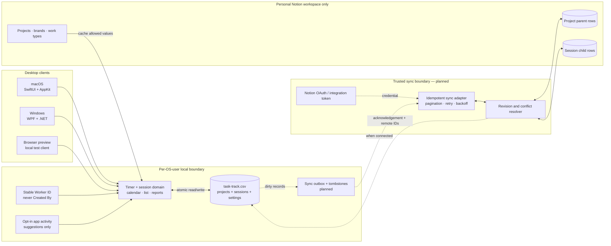
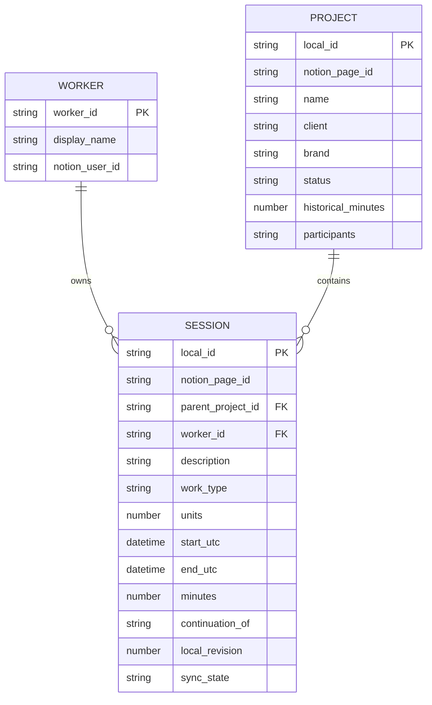
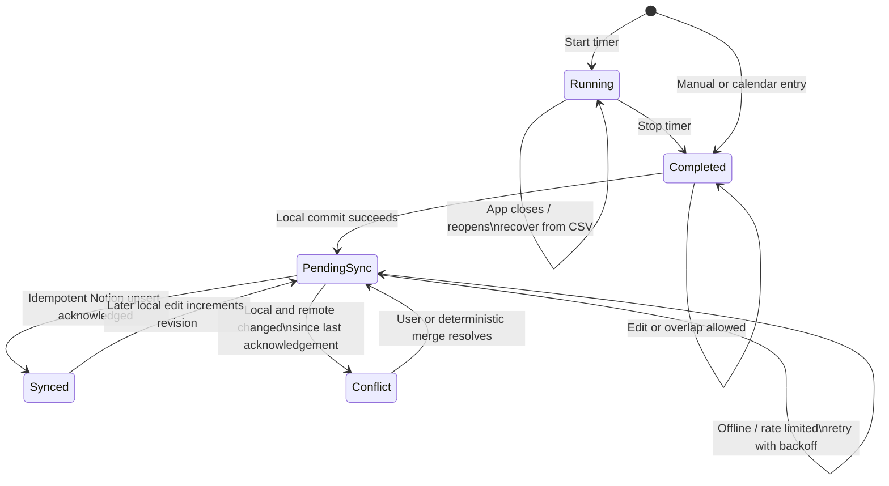

# Task Track + Notion logical architecture

Task Track is a local-first time tracker. The active timer and every edit are committed to the local CSV before the UI reports success. Notion is the shared synchronization and reporting boundary; it must never be required to stop a timer or recover work after a restart.

## System map

Solid lines are implemented local behavior. Dotted synchronization paths are the production Notion work still to be built.

## Data ownership

| Data | Operational authority | Synchronization rule |
| --- | --- | --- |
| Active timer | Local CSV | Save immediately; upload only as a recoverable draft if desired. |
| Completed session | Local CSV until acknowledged | Upsert idempotently by a stable session UUID. |
| Projects, brands and work types | Notion when connected; cached locally | Pull changes, retain the cache offline, and never discard an unsynced local session if its project is archived remotely. |
| Worker identity | Authenticated Task Track `Worker ID` | Store explicitly in every session. `Created By` may be an integration bot and is audit metadata only. |
| Rollups and totals | Derived | Recalculate locally for offline UI. Let Notion formulas/rollups calculate their own remote values; never write formula fields. |

## Record relationship

`Parent item` and `Sub-items` represent the project/session hierarchy. Resumed work creates another physical interval with `Continuation of` pointing to the logical task, so list totals can combine it without losing the exact calendar intervals.

## Session lifecycle

The current app implements states through `Completed` and durable local recovery. Explicit `PendingSync`, `Synced`, conflict metadata and deletion tombstones are planned.

## Required Notion contract before enabling writes

The personal database needs writable properties that are not formulas or rollups:

- `Local ID` (unique text): stable project/session UUID used for idempotent upsert.
- `Worker ID` (text): authenticated owner used by list and calendar filters.
- `Parent item` (relation): session to project.
- `Session Start`, `Session End`, `Session Minutes`, `Type of Work`, `Units`, `Recorded By`.
- Optional `Local Revision`, `Deleted At` and `Sync State` for conflict handling and tombstones.

The existing personal sample already provides most business fields, but a stable unique ID and the final conflict/deletion policy must be confirmed before production writes. No team workspace should be shared with the integration.

## Sync algorithm — planned

1. Commit the user action to a temporary file and atomically replace the local CSV.
2. Mark the affected record dirty in a durable outbox; the UI succeeds without waiting for Notion.
3. When authenticated and online, query Notion by `Local ID` and upsert once. A trusted adapter owns the token; desktop/browser code never embeds it.
4. Store the Notion page ID, acknowledged local revision and content hash locally.
5. Pull paginated remote changes. Show only rows whose `Worker ID` matches the signed-in worker.
6. If only one side changed, apply it. If both changed, preserve both versions and request resolution instead of silently overwriting.
7. Retry transient failures with exponential backoff and jitter. Authentication or schema errors pause sync and leave the CSV untouched.

## Current implementation status

Implemented:

- One shared CSV contract with project rows, child session rows and stable IDs.
- Atomic saves, stale-file detection, legacy migration and active-timer recovery.
- Stable worker ownership and personal list/calendar filtering in the preview.
- Local operation without Notion and optional read/add access to the personal work-type catalog.

Still required for production Notion synchronization:

- Notion authentication and account-to-`Worker ID` mapping.
- Durable outbox, remote page-ID mapping, revisions and deletion tombstones.
- Idempotent push/pull adapter, pagination, retry/backoff and schema validation.
- A confirmed conflict policy and a recovery/import screen.
- End-to-end tests against a dedicated personal Notion test database.
